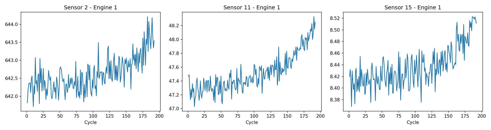
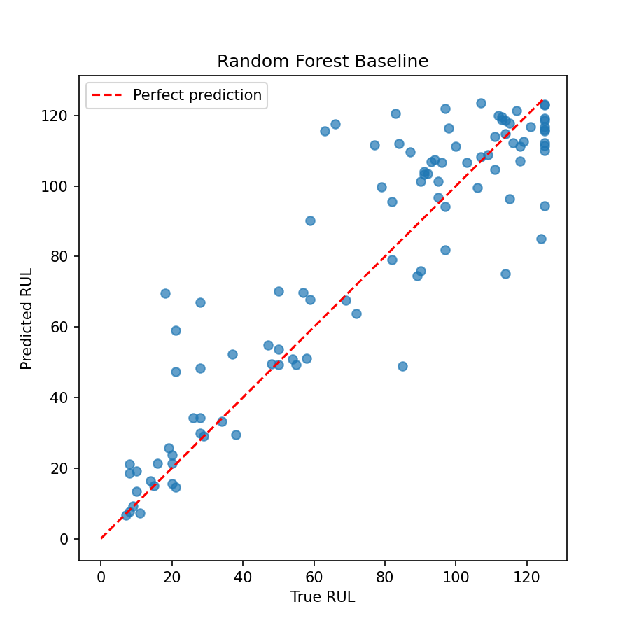
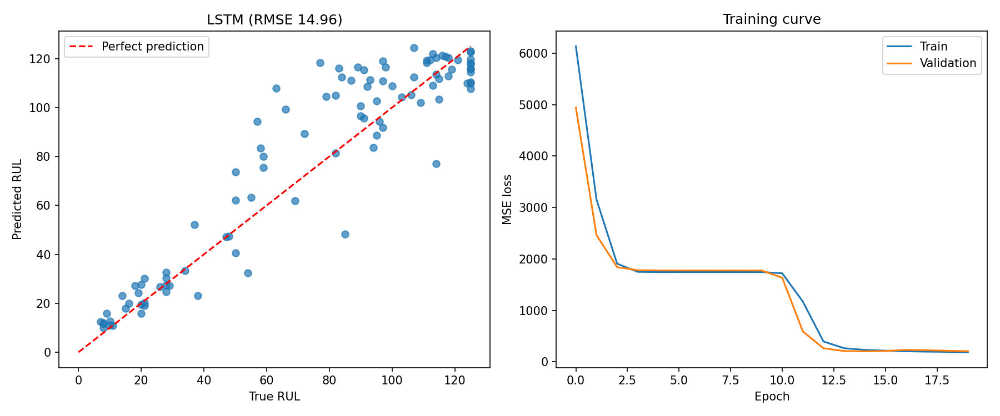

# Predictive Maintenance: Turbofan Engine RUL Prediction

Predicting the remaining useful life (RUL) of turbofan engines from sensor data using NASA's C-MAPSS dataset, comparing a random forest baseline against an LSTM.

## Why it matters
Unplanned failures of rotating equipment (turbines, compressors, pumps) are costly and dangerous in energy and industrial operations. Predicting how many cycles an asset has left lets teams schedule maintenance before failure instead of after it.

## Data
NASA C-MAPSS, subset FD001: 100 training engines run to failure and 100 test engines cut off before failure, with 21 sensors per cycle under one operating condition and one fault mode. RUL is capped at 125 cycles, which is standard practice because early-life degradation is negligible.

## Method
1. Removed constant sensors and operating settings that carry no information.
2. **Baseline:** random forest on single-cycle sensor readings.
3. **LSTM:** scaled sensors (MinMax, fit on training data only), 30-cycle sliding windows per engine, two LSTM layers (64 and 32 units) with dropout, early stopping. Validation used 10 held-out engines, split by engine to avoid leakage.
4. Evaluated on the official test set at each engine's last recorded cycle, using RMSE.

## Results
| Model | Test RMSE (cycles) |
|---|---|
| Random forest baseline | 17.22 |
| LSTM (30-cycle window) | 14.96 |

The LSTM reduces error by about 13% over the baseline.

## Limitations and next steps
- Only FD001 (single operating condition). FD002 to FD004 add more conditions and fault modes and would be a harder test.
- Single training run with one random seed, so results vary slightly between runs.
- Next: hyperparameter tuning, a longer window, and a comparison with a GRU or a 1D-CNN.

## Run it
Open `01_baseline.ipynb` in Google Colab, upload `train_FD001.txt`, `test_FD001.txt` and `RUL_FD001.txt` from the [NASA C-MAPSS dataset](https://data.nasa.gov/Aerospace/CMAPSS-Jet-Engine-Simulated-Data/ff5v-kuh6/about_data), and run all cells.
